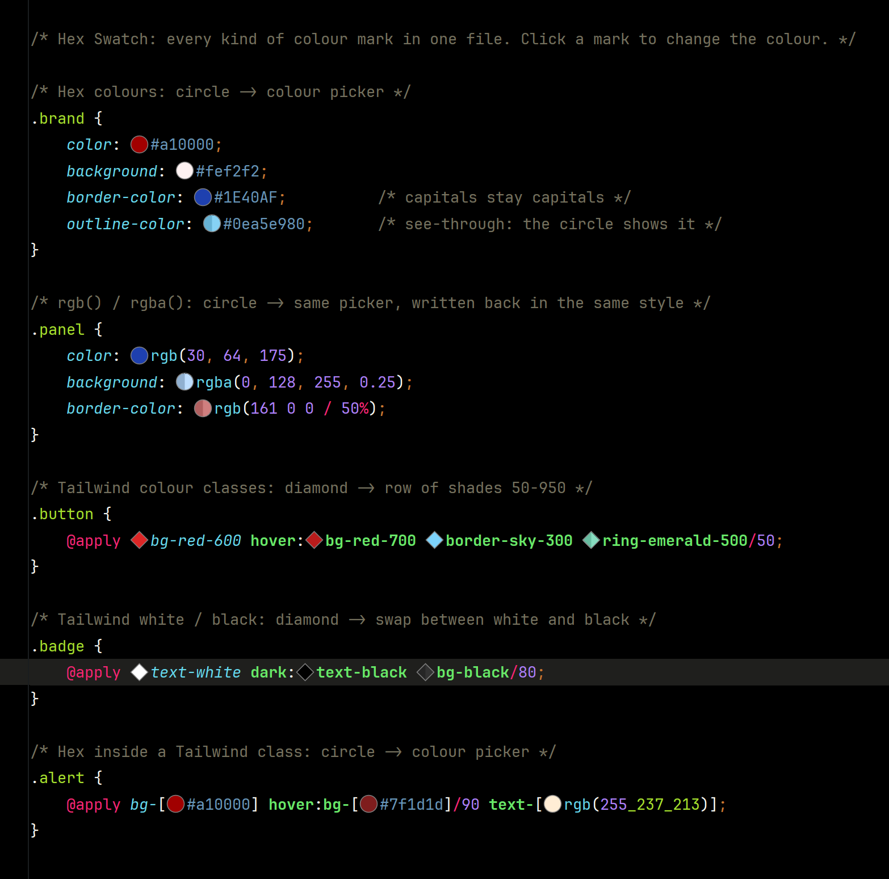
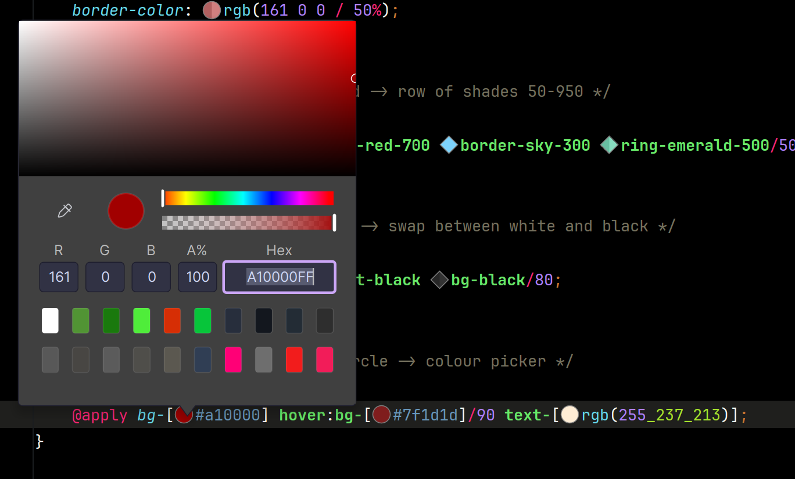
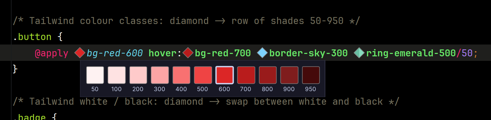
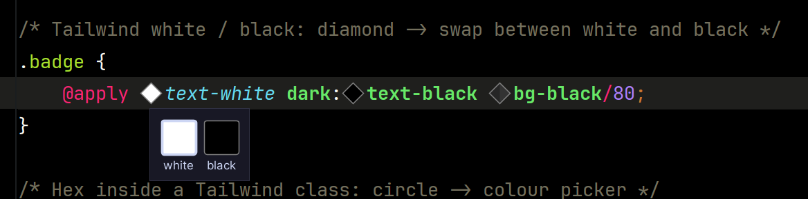

# Hex Swatch

A JetBrains IDE plugin (PhpStorm, WebStorm, IntelliJ IDEA and the rest, 2023.3+) that puts a small colour mark
before every colour in **any** file, including places the IDE's own swatches miss, such as Tailwind classes.

- **Hex colours** (`#abc`, `#aabbcc`, `#aabbccaa`, also inside `hover:bg-[#a10000]/50`): a **circle**.
  Click it for the IDE's colour picker; the hex updates as you drag.
- **rgb() / rgba()** (`rgb(255, 0, 0)`, `rgba(0,128,255,.5)`, `rgb(255 0 0 / 50%)`): a **circle** too, same picker.
  The new colour is written in the same style (commas or spaces, alpha as decimal or %).
- **Tailwind colour classes** (`border-red-600`, `hover:text-sky-300/50`): a **diamond**.
  Click it for a row of that colour's shades, 50 to 950; only the shade number changes.
  `text-white`, `bg-black/50` and the like get a diamond too: click it to swap between white and black.
  Colours follow the project's Tailwind version (3 or 4, read from `node_modules` or `package.json`).

It reads the plain text, so it works in CSS, Blade, HTML, JS, PHP, Vue, Markdown and anything else. The scan runs
300 ms after you stop typing; files over 2 MB are skipped. It changes no IDE settings.

## Screenshots
Every kind of mark in one file ([`docs/screenshots/demo.css`](docs/screenshots/demo.css)):

Click a circle for the colour picker, even inside a Tailwind class:

Click a diamond for the row of shades:

Or swap white and black:

## Install
- **Marketplace:** Settings → Plugins → Marketplace → search "Hex Swatch".
- **From a zip:** Settings → Plugins → ⚙ → Install Plugin from Disk → `hex-swatch-<version>.zip`.

## Optional: hide the Tailwind plugin's own swatches
The IDE's Tailwind CSS plugin draws its own colour swatch on Tailwind classes, so with Hex Swatch you see two.
To keep only the diamonds:

1. Settings → search **Tailwind CSS** (Languages & Frameworks → Style Sheets → Tailwind CSS).
2. In the **Configuration** JSON, change `"colorDecorators": true` to `"colorDecorators": false`.
3. OK. If they don't go at once: Ctrl+Shift+A → **Restart Tailwind CSS Service**.

If the swatches come back in another project, repeat it there (the Tailwind plugin may store it per project).

## Build
Needs any JDK 17+ to run Gradle (Gradle downloads the Java 17 used for compiling).

    ./gradlew buildPlugin    # -> build/distributions/hex-swatch-<version>.zip
    ./gradlew verifyPlugin   # JetBrains' compatibility check

All the code is one commented file: `src/main/java/hexswatch/HexSwatchListener.java`, registered in
`src/main/resources/META-INF/plugin.xml`.

## New version
1. Bump `version` in `build.gradle.kts`.
2. Add a block at the top of `<change-notes>` in `plugin.xml`.
3. `./gradlew buildPlugin verifyPlugin`, then upload the zip on the Marketplace.

## Licence
MIT, © GTDB ([gtdb.org](https://gtdb.org)).
